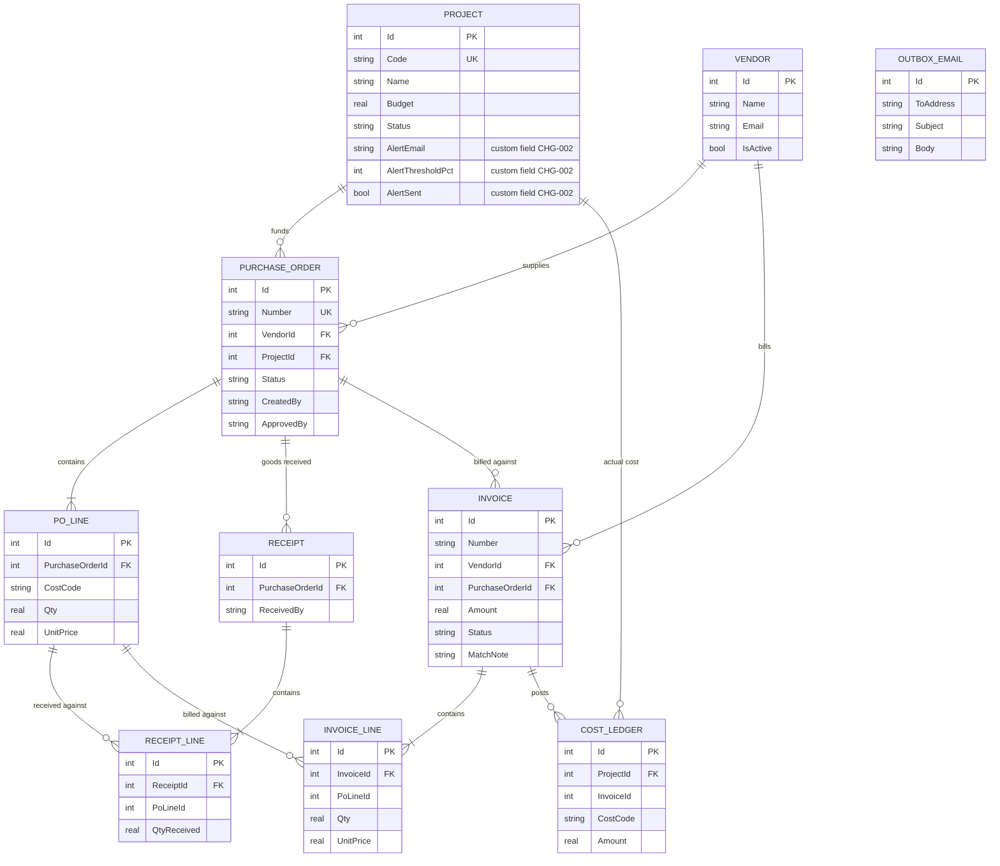

# Procurement and project-costing system

A small procure-to-pay backend modelled on what a construction company's finance, project management and procurement teams need: raise a purchase order, get it approved, receive goods, match the vendor invoice, and post the cost to the project budget. Built with ASP.NET Core (C#), Entity Framework Core and SQLite.

It is a learning project, not a product. It shows purchase orders, three-way match, budget versus actual, customization and change documentation in working code.

## Status: what has and hasn't been run

| Part | State |
|---|---|
| Business rules library (`Erp.Core`) and its 24 unit tests | Compiled and run: 24 pass |
| The four report SQL files (`src/Erp.Api/Sql`) | Run against SQLite with a matching schema and seed-like data; results checked by hand |
| CHG-002 apply and rollback SQL | Run against SQLite: columns added, then removed |
| CSV console app (`tools/CsvReport`) | Built and run on the sample file |
| ASP.NET API, EF Core model, integration tests, Dockerfile, CI workflow | **Written but not yet compiled or run.** The environment this was written in could not download NuGet packages. First `dotnet build` and `dotnet test` on your machine is the real check, and may turn up small compile errors. |
| Screenshots | **Not taken yet.** See "Screenshots" below. |

## What it does

```
Project --- PurchaseOrder ---< PoLine
                |  \
                |   `--< Receipt ---< ReceiptLine      (what actually arrived)
                `--< Invoice ---< InvoiceLine          (what the vendor bills)
                          \
                           `--> CostLedger --> Project (actual cost vs budget)
```

### Business rules

| Rule | Where |
|---|---|
| A PO above the approval threshold (default 10,000) waits for approval; at or below it auto-approves | `PurchaseOrder.Submit` |
| The creator of a PO cannot approve it (separation of duties) | `PurchaseOrder.Approve` |
| Goods can only be received against an approved PO, and not beyond the ordered quantity | `ProcurementService.ReceiveAsync` |
| **Three-way match.** An invoice posts only if the PO is approved, vendor agrees, header total equals its lines, unit prices are within 2% of the PO, and billed quantity does not exceed received-and-not-yet-billed quantity | `ThreeWayMatcher.Match` |
| A matched invoice posts to the cost ledger, one row per cost code, against the PO's project | `InvoicePosting.Plan` |
| **Business event.** When posted cost reaches the project's alert percentage (default 90) of budget, one email is queued to the project's alert address | `BudgetThresholdCrossed`, `BudgetAlerts` |

### Reports (SQL files, exposed as endpoints)

| Report | Endpoint | File |
|---|---|---|
| Budget versus actual by project | `GET /reports/budget-vs-actual` | `budget_vs_actual.sql` |
| Open purchase orders | `GET /reports/open-purchase-orders` | `open_purchase_orders.sql` |
| Invoices that don't match | `GET /reports/unmatched-invoices` | `unmatched_invoices.sql` |
| **Data validation** (flags bad records) | `GET /reports/validation` | `validation_checks.sql` |

The validation report runs 11 checks: bad PO line values, POs without lines, approved POs above the threshold with no human approver, self-approved POs, open POs for inactive vendors, over-received lines, invoice header vs line totals, duplicate invoice numbers, invoice vendor differing from the PO vendor, posted invoices with no ledger rows, active projects with no budget. The demo data plants several of these on purpose.

### Customization example (custom fields + business event)

CHG-002 adds three custom fields to `Project` and a business event on top of them, with an apply script and a rollback script. See [docs/CHANGES.md](docs/CHANGES.md) for the full change record and [docs/ERP_CONCEPTS.md](docs/ERP_CONCEPTS.md) for the ERP vocabulary this maps to (custom fields, business events, generic inquiries, graphs, BQL).

## ER diagram



`OUTBOX_EMAIL` has no foreign keys: it stands in for an email server, and the budget event writes to it.

## Run it

You need the [.NET 8 SDK](https://dotnet.microsoft.com/download). SQLite needs no setup.

```bash
dotnet run --project src/Erp.Api
```

Open `http://localhost:5000/swagger` (the console prints the actual port). On first start the app creates `erp.db` and loads demo data (`Erp:SeedDemoData` in `appsettings.json`). Delete `erp.db` to start fresh.

Demo walk-through:
1. `GET /reports/budget-vs-actual`: P-1002 sits at about 91.7% of budget.
2. `GET /outbox`: one budget alert email is waiting for P-1002's project manager.
3. `GET /reports/open-purchase-orders`: PO-0002 is pending approval; PO-0003 is approved but only partly received.
4. `GET /reports/unmatched-invoices`: invoice `AS-5530` was held because it bills 200 units and only 120 arrived.
5. `GET /reports/validation`: the planted bad records show up.
6. Try the rules yourself: `POST /purchase-orders/2/approve` with `{"approver": "alice"}` is refused (creator); with `{"approver": "bob"}` it succeeds.

### Tests

```bash
dotnet test
```

- `tests/Erp.Tests/Core`: rules with no database (approval, three-way match, posting, budget alert).
- `tests/Erp.Tests/Api`: the real service and the real report SQL against in-memory SQLite, including the demo data and the validation checks.

### Docker

```bash
docker build -t procurement-costing .
docker run --rm -p 8080:8080 -v erpdata:/data procurement-costing
# http://localhost:8080/swagger
```

### CSV console app

`tools/CsvReport` reads a CSV of invoices, rejects bad rows with a reason, and prints totals by vendor, project and month:

```bash
dotnet run --project tools/CsvReport -- tools/CsvReport/sample/invoices.csv
```

### CI

`.github/workflows/ci.yml` restores, builds and tests on every push and pull request, then builds the Docker image and smoke-tests the reports.

## Screenshots

Not captured yet. After the first successful run, take these four and save them in `docs/screenshots/` with these names, then they will render below:

1. `swagger-overview.png`: the Swagger page listing the endpoints
2. `budget-vs-actual.png`: response of `/reports/budget-vs-actual`
3. `validation.png`: response of `/reports/validation`
4. `outbox-alert.png`: response of `/outbox` showing the budget alert

```markdown


```

## Project layout

```
src/Erp.Core       entities, business rules, events (no dependencies; fully unit-tested)
src/Erp.Api        ASP.NET Core minimal API, EF Core (SQLite), services, report SQL in /Sql
tests/Erp.Tests    xUnit tests
tools/CsvReport    console app: CSV in, report out
db/changes         SQL to apply a schema change to an existing database
db/rollback        SQL to undo it
docs/              CHANGES.md (change log with rollback), ERP_CONCEPTS.md
```

## What I'd do differently

- **Real migrations.** The app uses `EnsureCreated`, so the SQL in `db/changes` is hand-written. With EF Core migrations each change would be generated, versioned and reversible with `dotnet ef database update <previous>`.
- **SQL Server and `decimal(18,2)`.** Money is stored as `REAL` because SQLite has no decimal type and the reports use SQL `SUM`. Floating point is the wrong type for money in production.
- **Authentication and roles.** Approver names are plain strings in the request. A real system would take identity from a login and enforce roles (requester, approver, AP clerk).
- **Enforce unique invoice numbers per vendor.** I left it open so the validation report has something to catch from imports; in production the database constraint comes first and the check is a safety net.
- **Real email.** Alerts go to an outbox table. A background worker would send them and set `SentAt`.
- **Partial matches and credit notes.** The match is all-or-nothing and there are no credit memos, retainage or change orders, which a construction company would need.
- **Audit trail.** Approvals and postings should write who/when to an append-only log.
- **More test coverage.** Endpoint-level tests with `WebApplicationFactory` and a test for the SQL on SQL Server as well as SQLite.
